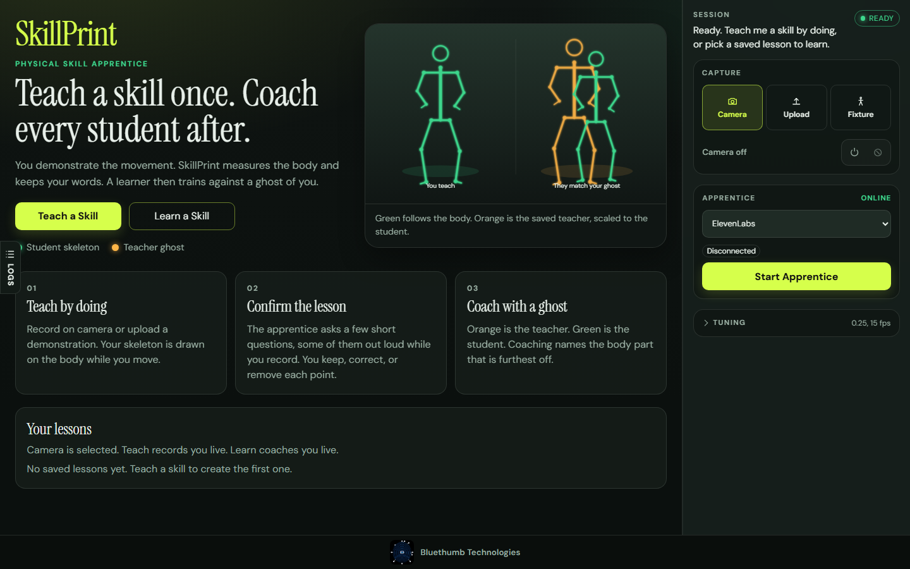
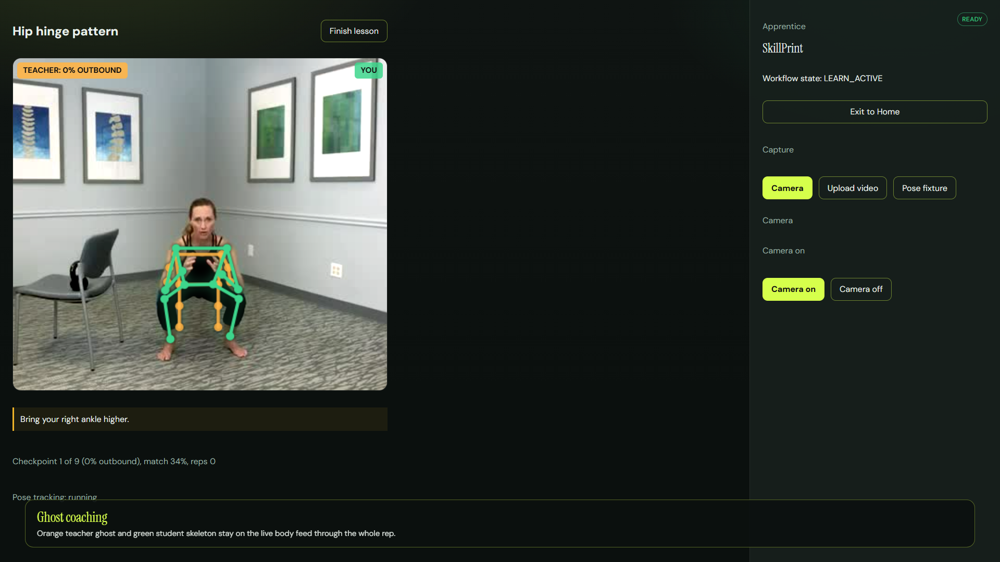
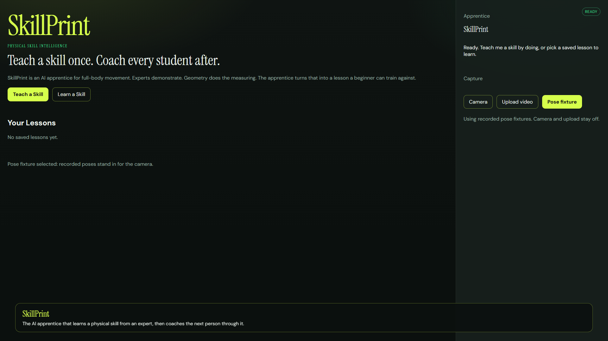
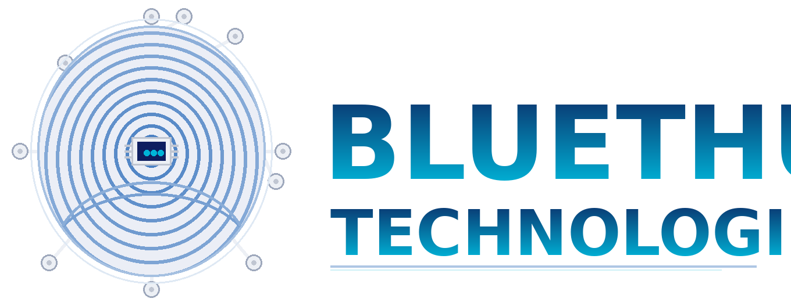

<p align="center">
  
</p>

# SkillPrint

> **Hosted App: [Open SkillPrint](https://skillprint.emranb.chatgpt.site)**
>
> Sign in with the owner's ChatGPT account. This deployment runs the browser/offline app; server sync and live ElevenLabs features require backend hosting.

**Teach a skill once. Coach every student after.**

An expert demonstrates a physical skill. SkillPrint measures the body, keeps the expert's words, and turns that into a lesson. The next person trains against a ghost of the teacher. Coaching names the joint that is off.

The engine does not invent technique. Geometry is measured in the app. Meaning comes from the expert.

<p align="center">
  
</p>

<p align="center"><em>Orange is the teacher ghost. Green is the student, drawn on the live body.</em></p>

## Watch

Two short films. Click a still to play.

<table>
  <tr>
    <td width="50%" valign="top">
      <a href="https://github.com/emranB/skill-print/blob/main/videos/skillprint-product.mp4">
        
      </a>
      <p><strong>Product</strong> · 36s · <a href="https://github.com/emranB/skill-print/blob/main/videos/skillprint-product.mp4">Play</a></p>
      <p>Home, naming a skill, reviewing reps, capture questions, teach-back, the lesson library, and ghost coaching.</p>
    </td>
    <td width="50%" valign="top">
      <a href="https://github.com/emranB/skill-print/blob/main/videos/skillprint-tech.mp4">
        
      </a>
      <p><strong>In the app</strong> · 36s · <a href="https://github.com/emranB/skill-print/blob/main/videos/skillprint-tech.mp4">Play</a></p>
      <p>Live navigation: teach a lesson, then learn with both skeletons on the camera feed.</p>
    </td>
  </tr>
</table>

Files also live in the repo: [videos/skillprint-product.mp4](videos/skillprint-product.mp4) and [videos/skillprint-tech.mp4](videos/skillprint-tech.mp4).

## How it works

1. **Teach by doing.** Record on camera or upload a demonstration. A skeleton with spine, head, hands, and feet is drawn on the body. Missing joints show in red.
2. **Confirm the lesson.** The apprentice asks only what was not already said or shown: why a shape matters, what to watch, what must never happen. During a live camera session those questions can be asked aloud. You keep, correct, or remove each point.
3. **Coach with a ghost.** The learner answers one prediction question, then moves. Orange is the saved teacher, scaled to the student. Green is the student. Cues name the body part that is furthest off.

A lesson is a named movement, not a hard-coded sport. Saved lessons are `lessons/<id>.json` at the project root, so a deploy that includes that folder opens with the library already loaded.

Screen-by-screen copy: [docs/PRODUCT.md](docs/PRODUCT.md). Demo path: [docs/DEMO_CHECKLIST.md](docs/DEMO_CHECKLIST.md).

## Run locally

Node 20+, current desktop Chrome or Chromium. Camera/microphone require localhost or HTTPS.

```
./run.sh
```

The shell helper stops leftover listeners on 5173 and 8000, then starts `npm run dev`. On Windows PowerShell use the commands below instead. Docker is a separate path.

```powershell
Copy-Item .env.example .env # only when .env does not already exist
npm install
npm run dev
```

- UI: http://localhost:5173
- API: http://localhost:8000 (Vite proxies `/api`)

### 3D movement runtime

New camera/upload lessons use **MediaPipe Pose Landmarker Heavy in VIDEO mode**, unit body-relative 3D bone directions plus joint bend angles. Each coherent teacher execution supplies **at most 20 ordered targets**. One browser-local causal matcher drives progress, ghost, coaching and completion; quality is measured against those same aligned targets, without a second acceptance veto. Normal teaching and learning require **no Python, RTMW3D worker, covariance calibration, CUDA, or discrete GPU**. GPU acceleration is preferred when available; CPU fallback is functional but slower.

**The teacher's demonstration defines correctness for that lesson.** A learner can complete a trajectory with imperfect match quality; matching a high-quality beginning alone is not completion. Scores describe similarity to that teacher, not globally correct technique.

One coherent demonstrated execution is one independent teacher reference. Live Teach records a single execution without multi-repetition segmentation. Longer uploaded recordings can propose several executions; the final review lets the teacher replay, include or exclude each proposal and retry the recording. Fragments/unusable proposals cannot participate in matching; ineligible reference records can remain for provenance with their rejection reason. At least one usable included execution is required; no expected repetition count is forced.

**Cycles** produce `REP_SUCCESS` when the ordered trajectory completes, finalize quality, then reset for the next attempt. **Sequences** produce `SEQUENCE_COMPLETE` once and never wrap. Both require start-compatible geometry, meaningful ordered movement and observed terminal evidence: no mandatory apex or generated dwell. Explicit teacher-requested holds remain required. Progress reaches 100% only on completion; elapsed playback time and EOF never create a completion.

**Match Difficulty Level** (`pose.matchDifficulty`, 1-100, default 75): "Controls how closely SkillPrint follows each stage of the learned movement." Target counts at **1/20/50/75/80/99/100 are 4/7/12/16/17/20/20**, capped by available distinct geometry. Difficulty changes resolution only, not model, representation, confidence **0.3**, explicit holds, fixed 3:1 direction/bend weights or geometric tolerance **0.25**. Endpoint-preserving geometric selection retains actual poses from one source; pauses do not consume targets. Independent cursors search at most three targets forward, never regress or borrow phases. The orange ghost represents the current aligned teacher target, not elapsed video time or an average body. Generic geometric coaching describes bone direction/bend discrepancies; confidence masks suppress unreliable joints.

Production call graph:

```text
Teach camera/upload -> MediaPipe Heavy VIDEO -> articulated body-relative 3D
  -> one execution / optional reviewed proposals -> independent observed references
  -> LessonCompiler -> LessonSchema -> LessonRepository (IndexedDB + optional server sync)
Learn camera/upload -> same Heavy VIDEO + descriptor -> LearningRun
  -> ArticulatedProgressTracker (one causal ordered <=20-target alignment)
  -> REP_SUCCESS / SEQUENCE_COMPLETE + AlignedMovementQuality -> results
```

Bone directions retain signed 3D orientation; bends alone are not the representation. Uploaded learners and webcams share this matching core. Local direction uses displacement since reaching the current target, not individual frame jitter. Upload calibration uses observed learner poses, rewinds to zero, then finishes automatically at EOF with one final evaluation and no camera/microphone acquisition. The shared pose loop pauses recorded playback during inference and samples by media time, so inference stalls do not discard movement stages. Webcam capture remains real-time. Recorded playback can therefore take longer than the video's duration; neither playback pacing nor FPS determines matching progression.

The new identifier is `mediapipe-articulated-3d-v1`. Lesson persistence retains kind, independent raw source observations, <=20 authoritative targets, confidence masks, start/terminal geometry and explicit holds. Malformed or mixed-representation lessons fail validation. Legacy 2D routes to `ProgressTracker`, RTMW3D to its explicit optional `LocalProgressTracker`/worker, and previously saved `mediapipe-heavy-body3d-v1` OAS lessons to `HeavyProgressTracker`; geometry is never silently migrated. Existing articulated lessons are sampled to <=20 runtime targets without rewriting their stored sources. Full-history online DTW and the old completed-candidate DP scorer are offline/historical, not authoritative new-path progression or completion.

The [Final 20-Target MVP Release](docs/MOVEMENT_3D_VALIDATION.md#27-final-20-target-mvp-release) records fresh teacher, dance and independently performed learner evidence. The five coherent squat sources self-replay at all five tested difficulties; the final frozen learner runs naturally produce **4/4/4/4/4 reps**, with completed match quality **86.67/84.65/87.31/86.53/86.99%** and zero setup/turn/exit completions. Earlier five-event and failed replay results remain archived. Endpoint safeguards were corrected using teacher reversal and generic regressions, not learner counts. Teacher-relative geometric completion is not a certified physical repetition count, and no expected learner count was imposed. Cross-teacher recognition is diagnostic, not a gate. Green software tests do not prove arbitrary movement-recognition accuracy. No learner dance or real-human webcam accuracy is claimed. Pose visibility/viewpoint, teacher-reviewed segmentation, slow CPU inference and the bounded 60-second candidate window remain MVP limitations.

**Final local status: FINAL MVP READY.** The prior failed release evidence, including the dance score **0.250686**, remains in `test-results/movement/release-mvp` and the historical closeout. The final ordered-target implementation removes the contradictory second completion veto without changing tolerance; actual dance upload self-replay now completes once, with zero reps, at all five tested difficulties. Fresh evidence is separate in `test-results/movement/final-20-target-mvp`. This local implementation has not been deployed to the hosted app.

`npm run dev` and `npm run build` verify the bundled Heavy asset hash and prepare local WASM from the locked npm dependency. New lessons can run in the browser-only hosted build; server sync and voice services still need a backend. Existing RTMW3D lessons require the optional compatibility runtime below.

The normal model/WASM path is browser-local at `/models/pose_landmarker_heavy.task` and `/models/wasm`, not a CDN or Python service. Provenance, official source and required SHA256 are in the [asset notice](public/models/MEDIAPIPE_NOTICE.md). If the Heavy file is absent, obtain that exact asset from the notice and run `npm run prepare:pose`; a missing/mismatched model intentionally fails setup. Teacher narration may use the configured backend transcription/voice service; local pose inference does not imply all teaching media stays on-device. No learner pose upload to a movement service is used by the new path.

#### Optional RTMW3D compatibility

Python 3.11+, then from the repository root (Windows; use `bin/python` instead of `Scripts/python.exe` on Linux):

```powershell
python -m venv .venv-movement
.venv-movement/Scripts/python.exe -m pip install -r requirements-movement.txt
.venv-movement/Scripts/python.exe -m pip install --no-deps -r requirements-movement-adapter.txt
```

Read the model rights notice before the separate, evaluation-only weights installation:

```powershell
.venv-movement/Scripts/python.exe src/movement/install_model.py --acknowledge-unresolved-weight-rights
.venv-movement/Scripts/python.exe -m pytest tests/movement3d -q
```

Only existing RTMW3D lessons send sampled JPEG frames to the local/backend Python worker. No camera permission is requested for uploads. RTMW3D weights are not committed, bundled, automatically downloaded, or redistributed. The default Docker image is Node-only; use `--build-arg INSTALL_RTMW3D_COMPAT=true` when building the optional compatibility image, with a separately rights-cleared model/provenance mount at `/app/.movement-models`. DTAIDistance remains offline/compatibility tooling, never the new live matcher.

Put a real `ELEVENLABS_API_KEY` and the existing `ELEVENLABS_AGENT_ID` in `.env`. Do not use `VITE_` for secrets. The key must never appear in the browser bundle, DebugBus, logs, or git.

When those credentials are present, the apprentice defaults to ElevenLabs. Set `SKILLPRINT_APPRENTICE_DEFAULT=mock` to force the offline wording used by automated tests.

```
npm run typecheck
npm run test
npm run test:e2e
npm run verify
```

Full camera-and-agent suite (fake camera, real extraction): `npm run test:level-b`.

Complete movement product regressions: `npx playwright test --config=playwright.movement.config.ts`. Slow empirical probes are opt-in, not silently treated as passing tests. To reproduce the separate final closeout on Windows, with the API/UI running and fixture files present:

```powershell
$env:MOVEMENT_VALIDATION_ROOT = 'test-results/movement/final-20-target-mvp'
$env:MOVEMENT_FINAL_VALIDATION = '1'
npx playwright test --config=playwright.movement.config.ts tests/movement/final-teaching.spec.ts
npx tsx src/scripts/level-b/validateArticulatedTeacher.ts --final
npx playwright test --config=playwright.movement.config.ts tests/movement/articulated-learner.spec.ts tests/movement/upload-lifecycle.spec.ts
npx tsx src/scripts/level-b/evaluateArticulatedLearner.ts --final --stream
$env:MOVEMENT_RELEASE_CLOSEOUT = '1'
Remove-Item Env:MOVEMENT_FINAL_VALIDATION
npx playwright test --config=playwright.movement.config.ts
```

The teacher script freezes the fresh complete lesson and matching files before learner inference; do not rerun it afterward and claim the freeze preceded those learner results. Preserve earlier evidence before repeating a run. Expert answers/review in these browser tests are simulated; the videos and production extraction/matching path are real.

## Docker

```
docker compose build
docker compose up
```

http://localhost:8000. Other host port: `SKILLPRINT_HOST_PORT=8100 docker compose up`.

Rate limits per client address: `/api/apprentice/structured` 40/min, `/api/elevenlabs/session` 20/min, `/api/transcribe` 10/min. `TRUST_PROXY` only behind a reverse proxy.

## CI and Sites deployment

GitHub Actions runs type checks, lint, unit tests, and a production build on pushes and pull requests to `main`. Successful pushes upload the browser build and Sites hosting manifest as a `sites-browser-build` artifact.

**Automatic Sites deployment is not configured.** The available Sites integration provides short-lived source credentials and authenticated publishing tools, not a persistent CI deployment credential. Do not store a temporary Sites token in GitHub secrets. Until a supported CI publishing connection is available, publish through the Sites integration in Codex using the project in `.openai/hosting.json`.

## Architecture

- Source of truth: [docs/PROJECT_PLAN.md](docs/PROJECT_PLAN.md), [docs/DATA_CONTRACTS.md](docs/DATA_CONTRACTS.md), [docs/FILE_INDEX.md](docs/FILE_INDEX.md)
- Handoff: [docs/IMPLEMENTATION_STATUS.md](docs/IMPLEMENTATION_STATUS.md)
- Stack: TypeScript, React, Vite, Express, MediaPipe Pose, ElevenLabs, Zod, IndexedDB, Vitest, Playwright, Docker Compose

The apprentice uses the ElevenLabs agent configured in `.env`. The app does not run a local LLM.

<p align="center">
  <a href="https://bluethumbtechnologies.ca">
    
  </a>
</p>
